# Monero's block weight and fee rules, v16 vs FCMP++ (v17): a simulation study

*Study branch `study-2026`, November 2026. The rules simulated are the reference code's (RULES.md): v16 =
monero-project/monero `master` ("2021 scaling"), v17 = seraphis-migration/monero `fcmp++-stage` (ArticMine's
MoneroScaling2026-03). This is an independent simulation study. Nothing here is a position of the Monero project.
Every number comes from the scenario files in `scenarios/`; `analysis/analyze.py` computes the headline ones into
`tables/key_numbers.md`. `run_all.sh` regenerates everything in about two and a half minutes.*

*This version was revised after a critical review of the first one. monerod's transaction pool limits (648 MB,
3 days) are now part of every scenario, and every broadcast transaction is accounted for: mined, dropped or still
pending. Blocks take transactions of different sizes in arrival order, Q5 runs to equilibrium, and Q1 reports
actual block sizes next to the limit. "What changed from the first version", near the end, lists the conclusions
that moved.*

## Summary of findings

**Q1 Growth capacity.** If demand stays above capacity, the long-term median M_L grows at exactly the clamp
ratio per 50,000 blocks (×1.7 for v16, ×1.2 for v17). This happened in every run whose fee level could pay to
cross M_N (with T_R = 3,000 and 9,093-byte transactions it never can; see Q6), and no run exceeded the bound.
The limit (the maximum block weight, 2·M_N) gets there first, and actual blocks follow later:

* **The limit on v17** reaches 10 MB in 0.3 days if miners fill blocks, 1.7 days with wallets on their default
  priority, and 6.2 days at the minimum fee. That is the short-term median reaching the 8× cap
  (2 × 8 × 625,000 = 10 MB). After that it takes about 625 days to reach 50 MB and about 903 days to reach 100 MB, whatever the fee.
* **The limit on v16** reaches 10 MB in 0.3, 3.5 and 13 days on the same three bases, 50 MB in 69–75 days and
  100 MB in 208–210.
* **Actual blocks lag the limit.** With rational miners, blocks run at about M_N, half the limit, so the first
  block of a given size comes one doubling of M_L later. With default wallets on v17, the first 10 MB block
  appears after 208 days, the first 50 MB block after 903 and the first 100 MB block after 1,181. On v16 they
  appear after 3.6, 140 and 278 days.
* **The fee level changes how fast the first ramp happens, not how fast M_L grows.** Any backlog lets even
  minimum-fee transactions pay for crossing M_N. The short-term median then ratchets up to its cap, and M_L grows
  at the clamp's rate. This is the design working as intended: the minimum fee is set so that a transaction of
  T_R bytes just pays for crossing M_N.
* **v17 sustains at most ×2.6 a year in M_L.** Starting from today's 38 tx/block, it keeps up with demand
  growing 200% a year for 5 years, with M_N carrying 2.3·M_L by then. At 400% a year it can't: 48% of the
  transactions sent over the 5 years are dropped from the full pool (41% on v16).

**Q2 Demand surges.** monerod's pool holds 648 MB and drops transactions after 3 days, so large surges end in
dropped transactions rather than week-long queues.

* **Up to 2× today's demand** is absorbed.
* **A one-day 5× surge** gives a mean wait of 274 blocks (9 h) on v17 against 131 on v16, and every transaction
  is mined. Bigger transactions are the reason, not the new rules: today's 38 tx/block fill 55% of v17's zone but
  32% of v16's. With v16 rules, the same 9,093-byte transactions and the same 55% of the zone (18 tx/block), the
  mean wait is 387 blocks, so at equal load v17 queues less.
* **Bigger one-day surges fill the pool on v17.** monerod then prunes the newest lowest-fee transactions. 53% of
  a 10× surge's transactions are mined, 26% of a 20× surge's and 11% of a 50× surge's. The figures for v16, with
  today's smaller transactions, are 100%, 66% and 26%. The pool is a fixed 648 MB whatever the zone, so at equal
  load the bigger chain loses more: the v16 control at 18 tx/block keeps 78% of a 10× surge against v17's 53%.
* **Paying more works.** In a one-day 5× surge on v17:

  | fee level | lowest | "normal" | 16× | 64× | f_X | users pay more |
  |---|---|---|---|---|---|---|
  | mean wait (blocks) | 466 | 273 | 26 | 1.8 | 0.8 | 2.7 |

  At the lowest level 8% are never mined. Users who pay more spend 0.0027 XMR per transaction on average.
* **The 8× surge cap makes no difference for surges of a day or less** (results identical to a 50× cap). For a
  week-long 20× surge it changes waits (116 vs 29 blocks) more than drops (80% vs 83% mined). It matters for a
  week-long 50× surge: 32% of its transactions are mined under v17, against 78% with a 50× cap.

**Q3 Spam and bloat.** Filler costs the same per byte under both rule sets: 20 XMR per GB at today's M_L. What
differs is how much the chain gives in return. Raising M_L costs about twice as much on v17 and takes twice as
long, because the clamp is 1.2 instead of 1.7. Adding bulk costs more on v17 beyond about 100 GB, but it is
faster, because v17's blocks are bigger. The totals below also reflect the two chains' free space at today's
38 tx/block, 55% of v17's zone and 32% of v16's, not only the rules.

* **Keeping blocks full at M_N** without a backlog costs 3.93 XMR/day on v17 vs 2.95 on v16. Both pay 20 XMR
  per GB; the ratio (×1.33) is the ratio of the free space, 274 kB against 206 kB per block.
* **It also raises every default wallet's fee about 4×.** wallet2 switches to "normal" when the last 10 blocks are
  over 80% full. On v17, users then pay 0.0007 instead of 0.00018 XMR per transaction. Across today's
  38 tx/block that is about 14 XMR/day extra, more than the attacker spends (on v16, 4.1 vs 3.0 XMR/day). Users
  don't wait any longer; they outbid the spam.
* **A backlog at the lowest fee** triggers the Q1 ratchet. Over 30 days it costs 1,823 XMR on v17, with M_N
  reaching 5 MB, vs 3,145 XMR on v16, with M_N reaching 15 MB. v17 costs less because it yields less: the spam
  adds 91 GB instead of 157 GB, at the same 20 XMR/GB, because blocks stop growing at the 8× cap.
* **Raising M_L at the lowest fee:** doubling costs 1,440 XMR over 279 days on v17 vs 687 XMR over 140 days on
  v16. Quadrupling costs 2,358 vs 866 XMR (558 vs 215 days). The times are the clamp ratios: four steps of
  50,000 blocks for ×1.2, two for ×1.7.
* **Adding data,** with the cheapest of four simple strategies (first seed; the spread between seeds is
  negligible, as the spam is deterministic):

  | data added | v17 | v16 |
  |---|---|---|
  | 10 GB | about 200 XMR, 53 days | about 200 XMR, 69 days |
  | 100 GB | 1,238 XMR, 235 days | 793 XMR, 185 days |
  | 1 TB | 12,542 XMR, 237 days | 1,073 XMR, 463 days |

  Growing the limit first is cheapest, because the minimum fee per byte falls as 1/M_L². v16's bigger clamp
  makes that cheaper; v17's bigger blocks make bulk arrive sooner.
* **A malicious miner below 50%** can't move M_L at today's demand, because both windows are medians. With honest
  demand at 90–95% of Z_M it can. Padding to the clamp for a year, a 45% miner raised M_L by 6–11% on v17 (2–7% on
  v16), and a 30% miner by up to 3%.
* **A 51% miner** padding to the clamp multiplied M_L by 1.44 in a year on v17 (1,481 XMR), against 2.89 on v16
  (17,857 XMR). It can also pad its blocks to M_N for free: 37.5 GB a year on v17.

**Q4 Recovery.**

* **M_N** returns to M_L within hours once the backlog is gone: 0.1–0.2 days after a 30-day episode.
* **M_L** stays at its peak for 50,000 blocks, then falls by at most the clamp ratio per 50,000 blocks, so it never
  decays faster than it grew.
* **After a year of maximum growth,** both rule sets need about 347 days to return to the penalty-free zone. Six
  months after demand stops, M_L is still 1.7× its starting value on v17 (1.08 MB) and 4.9× on v16 (1.47 MB).
* **Fees stay low meanwhile.** At the end of a growth year the minimum fee per byte is 0.16× its starting value on
  v17 and 0.005× on v16, which makes follow-up spam cheaper.
* **After a 2-year spam campaign** that pads blocks to the clamp, M_L is still 1.52 MB (v17) or 1.15 MB (v16)
  twelve months later.

**Q5 Fee market.**

* **At equilibrium,** once M_L has caught up with demand, wallets on default priority pay this much per
  2-in/2-out transaction:

  | demand | 0.5·Z_M | 0.8·Z_M | Z_M | 1.2·Z_M | 2·Z_M | 5·Z_M |
  |---|---|---|---|---|---|---|
  | v17 (XMR) | 0.00018 | 0.00044 | 0.00066 | 0.00046 | 0.00017 | 0.000027 |
  | v16 (XMR) | 0.00005 | 0.00012 | 0.00019 | 0.00013 | 0.00005 | 0.000008 |

  Above Z_M, fees fall as demand rises, because M_L grows with demand and fee levels scale as 1/M_L². Waits are
  short at every level, with a p99 of at most 1 block.
* **Getting there takes time.** At 5·Z_M, v17's M_L needs log 5 / log 1.2 ≈ 9 clamp steps of 50,000 blocks,
  about 1.7 years. In the first 139 days
  after demand jumps, M_L has taken only one step, so v17 wallets pay about 0.0006 XMR whatever the demand: 3.4× the
  equilibrium fee at 2·Z_M and 22× at 5·Z_M. The first version of this report presented those first-139-day fees
  as the steady state.
* **"Normal" is enough to make blocks grow** when demand is real. Once demand reaches Z_M, 45–47% of v17 blocks
  exceed M_N at equilibrium, by 0.8–3.8% on average.
* **A sudden step in demand is where auto priority struggles.** A chain with M_L at Z_M that is loaded with
  2·Z_M from the first block gives a p99 wait of 18 blocks on v17 (291 on v16) over the first 139 days.
* **A daily demand cycle around Z_M** (amplitude 0.5–0.9) gives mean waits of 20–57 blocks and a p99 of 48–108
  on v17. Low-fee transactions wait up to 440–510 blocks: M_N shrinks in each daily trough, and transactions sent
  at the lowest level just before a backlog are overtaken by every later "normal" one. Raising the fee during a
  backlog (users-pay-more) brings mean waits to 1–1.5 blocks, at 6.7–8.5× the fee.
* **How far past M_N a block can go,** with a deep pool on v17 at M_N = M_L = Z_M:

  | fee level | lowest | "normal" | 16× | 64× | f_X |
  |---|---|---|---|---|---|
  | largest block, ÷ M_N | 1.017 | 1.047 | 1.17 | 1.65 | 2 |

  Lower levels reach 2·M_N as M_N/M_L grows. Stressnet shows the effect live: 195 blocks were 0.1–4.1% over its
  10 MB penalty-free size.

**Q6 Parameter sensitivity** (576 rule sets; share of the variance of log(metric + 1) that each parameter explains
on its own):

| Parameter | Mainly controls |
|---|---|
| Clamp ratio | time to double M_L (100%, by construction); the cost of a 51% miner doing it (75%) |
| Surge factor | how fast the limit reaches 10 MB (57%) |
| T_R | the cost of keeping blocks full (79%, since the minimum fee is proportional to T_R); waits and the share mined in surges (21–49%); the cost of doubling M_L by spam (32%) |
| Z_M | second-order everywhere (≤ 28%) |
| Transaction weight | small, except where it exceeds T_R |

Interactions matter. For the surge and spam metrics, the five main effects together explain only 47–82% of the
variance. When the transaction weight is above T_R, a minimum-fee transaction can't pay to cross M_N at all; with
T_R = 3,000 the minimum-fee spammer never doubled M_L.

**Q7 The fork transition.** The reference code (`fcmp++-stage`) doesn't implement the spec's transitional rule.
The spec scales pre-fork block weights by 625/300 in every median that spans the fork (M_L, M_S, M_N and the
wallet's M_LW), and notes that this is "only necessary if MLOld > ZMOld".

* **At today's mainnet state** (M_L at the 300,000 floor) and ordinary demand, it makes no difference: the runs
  are identical.
* **With high post-fork demand it does, even with M_L at the floor.** With 3× today's transactions, M_N differs
  from 29–39 blocks after the fork, through the short-term window. With demand above capacity, M_L is 7.5% higher
  and the minimum fee per byte 14–15% lower from about 46,000 blocks after the fork: the scaled tail of pre-fork weights holds up the
  median once post-fork weights fill half the window. The spec says the medians are then "calculated normally".
  Two readings of that, scaling the stored long-term weights or recomputing them with v17's clamp, give the same
  result here.
* **If pre-fork M_L is above 300,000, it matters a lot.** Without rescaling, M_L at the fork is 625k instead of
  938k for X = 450k, and 1.0M instead of 2.08M for X = 1M. The minimum fee per byte jumps 2.3–4.5× at the fork,
  where with rescaling it stays nearly continuous. The gap lasts 146,000–200,000 blocks.

## Worth raising with the FCMP++ scaling implementers (jeffro256, ArticMine, MRL)

1. **The transitional rule is missing from `fcmp++-stage`, and its "only necessary if MLOld > ZMOld" note isn't
   quite right (Q7).**
   * **The code:** a read of `blockchain.cpp` on the branch (2 November 2026) found no rescaling of pre-fork
     weights in `get_next_long_term_block_weight`, `update_next_cumulative_weight_limit` or
     `get_long_term_block_weight_median`.
   * **With M_L at the floor, as on mainnet today:** sustained post-fork demand of 3× today's transactions makes
     M_N differ within 29–39 blocks. Demand above capacity gives M_L 7.5% higher from about 46,000 blocks on,
     under both readings of the rule.
   * **With pre-fork M_L above 300,000:** the differences are 2.3–4.5× in fees and up to 2.08× in limits, for over
     100,000 blocks.
   * **Suggestion:** either implement the rule, or amend the spec to match the code and drop or qualify the note.
   * **Evidence:** `tables/q7.md`, `figures/q7_fork.png`.
2. **A minimum-fee spammer raises every default wallet's fee about 4× (Q3; wallet-side).**
   `wallet2::adjust_priority` pays "normal" whenever the last 10 blocks were over 80% full. Keeping blocks at M_N
   costs a spammer 3.9 XMR/day on v17. It makes users pay 0.0007 instead of 0.00018 XMR per transaction, about
   14 XMR/day across today's demand, all of it going to miners. Worth checking that this is the intended response
   to minimum-fee filler. Evidence: `tables/q3.md`, Q3a.
3. **The default pool size, not the 8× cap, limits big surges (Q2).** monerod's `DEFAULT_TXPOOL_MAX_WEIGHT` is
   648 MB ("3 days at 300000"), unchanged on `fcmp++-stage`. At v17's 625 kB zone that is about 1.4 days of full
   blocks.
   * On v17 a one-day surge of 10× today's demand fills it, and the pool then drops the newest lowest-fee
     transactions: 47% of that surge's transactions are never mined (74% at 20×).
   * Whether the default should scale with Z_M is a trade-off: a bigger pool turns drops into longer waits.
   * Evidence: `tables/q2.md`, including the unbounded-pool comparison.
4. **The penalty-free zone in transactions (Q2).** 625 kB holds 69 2-in/2-out FCMP++ transactions, against about
   120 of today's in 300 kB. After the fork, moderate surges therefore queue about twice as long as today: 274 vs
   131 blocks for a one-day 5× surge. At equal transaction weight and equal load (v16 rules, 9,093-byte
   transactions, 18 tx/block = 55% of its zone) v17 still queues less: 274 vs 387 blocks.
5. **The 8× surge cap (Q2)** makes no difference for surges of up to a day once the pool limit is modelled. For a
   week-long 50× surge, 32% of transactions are mined under v17, against 78% with a 50× cap. This is a trade-off
   against Q3: under a 50× cap, a spammer's backlog could ratchet M_N to 50·M_L (31 MB at v17's zone) instead of
   5 MB.
6. **T_R and transaction weights (Q6).** Minimum-fee growth needs T_R ≥ transaction weight. 12,500 clears the
   standard FCMP++ weights (7,650 / 9,093 / 11,851), but only narrowly for 4-in/2-out. Larger transactions (up to
   the 178,063 limit) can't push blocks past M_N at the minimum fee.
7. **Wallet behaviour (Q2, Q5)** is wallet-side, but it decides user experience. Auto priority tops out at
   "normal" and there is no fee bumping. Low-fee transactions sent just before a backlog are therefore overtaken
   by later "normal" ones, and daily cycles at Z_M leave some waiting 440–510 blocks. A users-pay-more style
   escalation removed almost all waiting in every scenario, at 6.7–8.5× the fee. The 1,000-block wallet grace
   period caused no trouble in any run.
8. **Stressnet's scaling parameters are not mainnet's.** Its penalty-free zone is 10 MB
   (`CRYPTONOTE_BLOCK_GRANTED_FULL_REWARD_ZONE_V17 = 10,000,000`, marked stressnet-specific; its long-term weights
   are 8,333,333 = 10 MB × 5/6) and its long-term window is 10,080 blocks
   (`CRYPTONOTE_STRESSNET_BLOCK_WEIGHT_WINDOW_SIZE`) instead of 100,000, so M_L can step every 5,040 blocks
   (7 days) rather than every 50,000 (69 days). Growth, recovery and fee dynamics seen on stressnet therefore run
   about 10× faster than this report's v17 numbers, in a zone 16× larger. The surge factor is 8 on both. Stressnet's
   transaction weights match `get_fcmp_pp_transaction_weight_v1` exactly. (Parameters read from
   `seraphis-migration/monero` at d80596ad1, branch `fcmp++-beta-stressnet-v3`.)

## Methods

### Simulator and what was frozen

`wasm-sim/src/lib_core.rs` implements the consensus and fee rules. None of its functions were changed. All the
study's work happens around them:

* **Stepper.** `wasm-sim/src/lib_core/step.rs`, a child module that can call the private functions unchanged,
  splits the run loop into `begin_block` (medians, limits, fee levels) and `finish_block` (arrivals, block
  building, window updates). The order of operations is the core's.
* **Additions,** all off by default:
  * several transaction classes (sizes). Within a fee level, blocks take them in arrival order across sizes, as
    monerod's pool sorts by fee per byte, then receive time. A size that no longer pays for its penalty, or no
    longer fits, is passed over for the rest of the level, as `fill_block_template` does.
  * FIFO pool queues per fee level and size, which give exact wait times;
  * attacker-owned transactions;
  * miner padding;
  * a rule switch, with or without rescaling;
  * initialisation from a real chain;
  * pool expiry, and a pool size cap that prunes the lowest fee level first and, within it, the newest
    transactions (`tx_memory_pool::prune`). Every dropped transaction is recorded with its arrival block.
* **Regression.** `stepper_reproduces_core_exactly` checks that the stepper reproduces `run_simulation_core` bit
  for bit, including floating-point fees, in 90 configurations: run types 1–6 × v16 / v17 / Custom × rational
  miners, noise, users-pay-more and fixed levels. Further tests check the following:
  * the outcome with mixed sizes doesn't depend on the order the sizes are listed in, and no size starves;
  * the pool cap prunes in monerod's order;
  * pool expiry works;
  * both rescale readings behave as specified.
* **Checks.** `cargo test --release --lib` (15 tests) and `node tests/parity.mjs` (all PASS) pass.

### Harness

`study/` is a Rust crate that depends on `wasm-sim` by path.

* **Scenarios** are JSON files, expanded as cases (optionally crossed) × parameter grid × seeds.
* **Runs** go in parallel on all 12 cores (rayon). Each run is deterministic from its recorded seed.
* **Every user transaction is accounted for** by the block it was broadcast in:
  * mined (with its wait and fee);
  * rejected by the relay minimum;
  * expired;
  * pruned from the full pool;
  * or still pending at the end.

  The harness checks that these add up. Waits are over mined transactions; "mined within N blocks" is over
  everything broadcast.
* **Outputs:**
  * `summary.csv`: one row per run, with these cohorts (by broadcast block): the surge or attack window (`win_`),
    the time before it (`pre_`), and a steady-state window (`ss_`);
  * `events.csv`: exact values at window starts and ends, thresholds, the fork, and +1/3/6/12 months;
  * `runs.jsonl`: the full spec of each run;
  * `meta.json`: git commit, scenario text, seeds, timing. Generated outputs don't count towards the "dirty" flag;
  * gzipped series sampled every N blocks.
* **Memory** per run is bounded: series are streamed, and wait times go into an exact histogram (dense up to
  60 days, sparse beyond). The whole study takes about two and a half minutes.

| Model | How it works |
|---|---|
| Demand | constant (tx/block, bytes, or × Z_M); step surge (× multiplier for a duration); daily sine cycle; exponential growth (%/yr); "fill" (k × maximum block weight, i.e. permanently above capacity, optionally between two blocks); Poisson arrivals (exact sampler) or deterministic with fractional carry; a weighted transaction mix |
| Pool | monerod's defaults in every scenario: a 648 MB cap (`DEFAULT_TXPOOL_MAX_WEIGHT`), pruning the lowest fee level first and the newest transactions within it, and 3-day expiry (`CRYPTONOTE_MEMPOOL_TX_LIVETIME`). Dropped transactions are counted, not resent. `q2b_pool` repeats the large surges with an unbounded pool. |
| Spam attacker | a fixed fee level, `auto` or `top`. Modes: `fill_to` (each block, top the pool up to max(a·M_N, b·M_L) or the clamp ratio × M_L, so no backlog forms), `topup` (keep k·M_N of spam waiting), `rate`. Optional duration or XMR budget. Spend is counted when a transaction is included, at the fee then in force. |
| Malicious miner | each block is the attacker's with probability h (separate random stream). It builds the block like an honest miner, then pads with zero-fee filler to M_N, the clamp ratio × M_L, or 2·M_N. Its cost is the penalty above what the unpadded block would have paid. |
| Rule switch | v16 → v17 at block K, windows carried across. Reference behaviour: no rescaling. The spec's rule scales pre-fork weights × 625,000/300,000 in every median spanning the fork (long- and short-term, consensus and wallet), applied once at the fork. Two readings of "the medians are then calculated normally": `spec` scales the stored long-term weights; `spec_reclamped` recomputes them from the scaled block weights with v17's clamp around the scaled pre-fork M_L. Wallet grace (10 → 1,000) and the number of fee levels change at the fork. |
| Initial state | steady (windows filled with Z_M), or the last 100,000 mainnet blocks: heights 3,697,558–3,797,557 from a local mainnet node (`scripts/fetch_chain.py`, committed as `data/mainnet_weights.csv.gz`). Only Q7b uses the mainnet start. The other questions start at steady state, which matches today's mainnet M_L = Z_M = 300,000. |
| Measurement window | Q5's equilibrium runs last 800,000 blocks and measure the last 100,000 (`measure_from`); a table column flags any run whose M_L still moved by more than 1% in that window. |

### Baseline numbers taken from real chains (`tables/chains.md`)

* **Mainnet** averaged 38.4 transactions per block and 2,493 bytes per transaction over the last 100,000 blocks.
  The study's baseline demand is therefore 38 tx/block, with 2,500-byte transactions for v16.
* **v17 runs** use 9,093-byte transactions (FCMP++ 2-in/2-out), plus one mix of 25% 7,650 / 50% 9,093 / 25%
  11,851.
* **Stressnet** (testnet with the FCMP++ fork, version 18 from height 3,103,520, a local node):
  one-transaction blocks minus the coinbase are exactly 9,093 or 7,650 bytes.

### Assumptions (as in RULES.md, plus the pool)

* Transactions within a class have equal weight.
* Fees are the wallet levels in force when the transaction is *included*.
* Miners are rational: they take the highest level first, and add a transaction only if its fee covers the
  penalty it adds (closed form `affordable_txs`), unless `fill`. Within a level they go in arrival order;
  equally new transactions are taken smaller first and pruned larger first.
* Wallets follow `wallet2::adjust_priority`: the lowest level, or "normal" under a backlog or when the last 10
  blocks averaged more than 80% of M_N. Users-pay-more moves a growing share two levels up.
* The reward is the 0.6 XMR tail emission.
* Not modelled: the coinbase reserve, per-transaction weight limits, P2P message limits, and network or
  verification costs.

### Pilots and hand checks

Every question was first run as a small pilot (`scenarios/pilot/`).

* **Fill pilot:** v16 M_L went 300k → 510k → 867k at blocks 50k and 100k, and v17 went 625k → 750k → 900k,
  exactly ×1.7 and ×1.2. M_N sat at 50·M_L and 8·M_L. Blocks at 2·M_N paid the full 0.6 XMR penalty.
* **Spam check:** keeping v17 blocks at M_N for 7 days (Q3a) cost 27.6 XMR. By hand: the spammer adds whole
  9,093-byte transactions beside 38 user transactions (345,534 bytes), so 30 per block, at 2.0e-8 XMR/byte (the
  minimum level, rounded up to 2 significant digits): 30 × 9,093 × 2.0e-8 × 5,040 blocks = 27.5 XMR. Poisson user
  demand sometimes leaves room for a 31st. The first version computed this from 625,000 − 345,500 bytes, which
  gives 28.2, not the 27.6 it stated.
* **Analytic M_L bound and growth times:** checked in Q1.
* **Over-M_N table:** computed from the same formula `affordable_txs` uses. Its overshoots match the simulated
  mean overshoots in Q5.

## Results

### Q1 Growth capacity (`scenarios/q1_growth.json`, `q1b_demand_growth.json`; `tables/q1.md`)

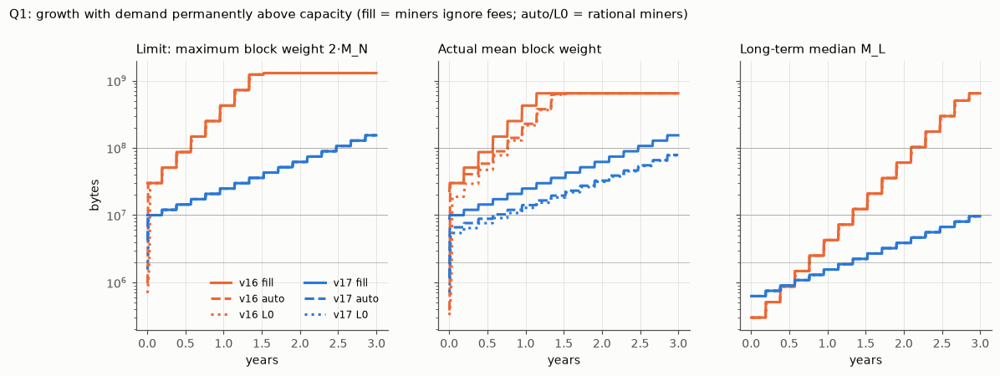

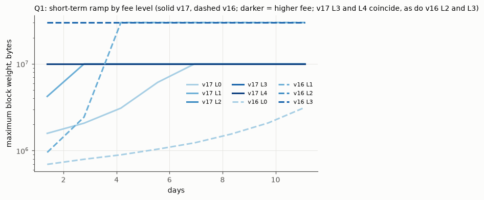

Days until the limit (2·M_N) and the first actual block reach a size, with demand at the maximum block weight
every block (selected rows; full table in `tables/q1.md`):

| rules | miners / fee | limit 10 MB | limit 50 MB | limit 100 MB | block 10 MB | block 50 MB | block 100 MB | M_L ×2 |
|---|---|---|---|---|---|---|---|---|
| v16 | fill (upper bound) | 0.3 | 69.4 | 208.3 | 0.3 | 69.4 | 208.3 | 138.9 |
| v16 | auto | 3.5 | 70.8 | 208.8 | 3.6 | 139.8 | 278.2 | 139.4 |
| v16 | lowest fee (L0) | 13.0 | 74.6 | 209.6 | 13.4 | 208.8 | 280.3 | 140.4 |
| v17 | fill (upper bound) | 0.3 | 625.0 | 902.8 | 69.4 | 625.0 | 902.8 | 277.8 |
| v17 | auto | 1.7 | 625.2 | 903.0 | 208.5 | 902.9 | 1,180.8 | 278.0 |
| v17 | lowest fee (L0) | 6.2 | 625.8 | 903.8 | 278.3 | 903.7 | 1,182.0 | 278.6 |

* **Analytic bound.** Over all 1.6 M-block runs, the largest M_L(b + 50,000) / M_L(b) was exactly 1.7000 (v16)
  and 1.2000 (v17), never more. With M_L stepping ×clamp every 50,000 blocks and the limit at 2·surge·M_L, the
  predicted times for the limit are 69.4 / 208.3 days (v16, 50 / 100 MB) and 625.0 / 902.8 days (v17). The
  simulations hit them exactly.
* **Why v17's first 10 MB block takes 69 days even with filling miners.** 1,099 transactions of 9,093 bytes weigh
  9.99 MB, just under the starting 10 MB limit, so a 10 MB block has to wait for M_L to step up once.
* **Exception: transactions larger than T_R.** v16 with 9,093-byte transactions at the minimum fee doesn't grow
  at all (M_L 300,069 after 6 years; `results/q1_growth/summary.csv`). A minimum-fee transaction larger than T_R (3,000) can't pay the penalty for
  crossing M_N. This is the T_R-vs-weight effect of Q6.
* **v16 at very large sizes.** At L0/L1, v16 eventually falls below the clamp bound (left panel, dotted). The
  overshoot allowed at a fixed fee shrinks relative to M_N as M_L grows, so after a step the short-term median
  can no longer climb back above 1.7·M_L.

Exponential demand growth from 38 tx/block over 5 years (8 seeds, Poisson, default wallets). "Dropped" is the
share of all transactions sent that were pruned from the full pool or expired:

| growth/yr | demand at year 5 (tx/block) | v17 M_L / M_N at 5 yr (MB) | v17 dropped | v16 M_L / M_N (MB) | v16 dropped |
|---|---|---|---|---|---|
| 50% | 289 | 2.4 / 2.7 | 0 | 0.67 / 0.74 | 0 |
| 100% | 1,216 | 9.7 / 11.2 | 0 | 2.7 / 3.1 | 0 |
| 200% | 9,234 | 36.6 / 84.2 | 0 | 18.7 / 23.1 | 0 |
| 400% | 118,750 | 45.8 / 366 | 47.5% | 85.6 / 93 | 40.7% |

The v17 clamp allows ×1.2^5.26 ≈ ×2.6 a year in M_L. Faster growth is carried for a while by the 8× surge
headroom: M_N/M_L reached 2.3 after 5 years at +200% a year.

### Q2 Demand surges (`scenarios/q2_surge.json`, `q2b_pool.json`; `tables/q2.md`, `tables/q2_surge_all.csv`; 16 seeds per point)

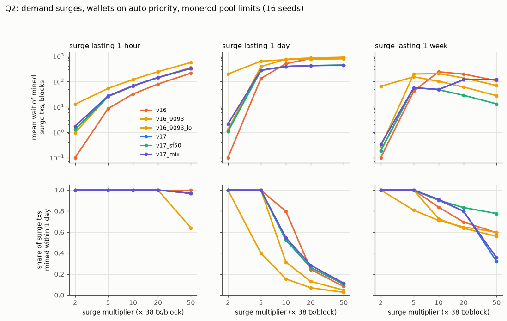

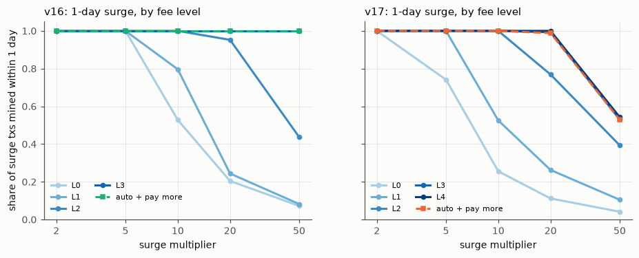

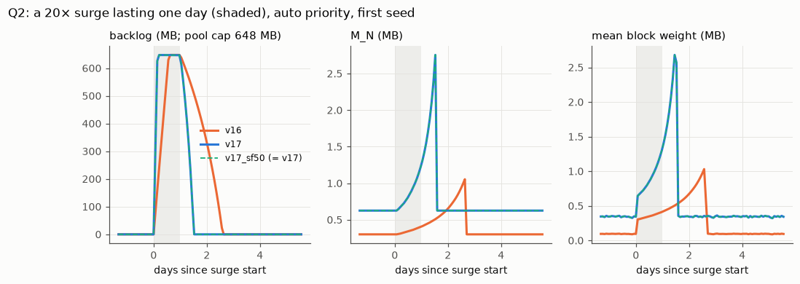

All surges start from 38 tx/block (Poisson), which is 55% of v17's penalty-free zone and 32% of v16's. "Wait"
is counted in blocks (2 minutes each), for the transactions that arrive during the surge and are mined; a wait
of 0 means mined in the next block. "Mined" is the share of those transactions ever mined.

One-day surge, wallets on auto priority (mean wait in blocks, share mined):

| surge | v16 (2,500 B) | v16, 9,093 B, 38 tx | v16, 9,093 B, 18 tx | v17 | v17 mix | v17 with 50× cap |
|---|---|---|---|---|---|---|
| 2× | 0, 100% | 196, 100% | 1, 100% | 1, 100% | 2, 100% | 1, 100% |
| 5× | 131, 100% | 627, 78% | 387, 100% | 274, 100% | 277, 100% | 274, 100% |
| 10× | 500, 100% | 719, 39% | 745, 78% | 390, 53% | 387, 55% | 390, 53% |
| 20× | 795, 66% | 757, 19% | 844, 39% | 422, 26% | 418, 28% | 422, 26% |
| 50× | 889, 26% | 777, 8% | 893, 16% | 438, 11% | 432, 11% | 438, 11% |

* **Two v16 controls with v17's transaction weight.** At 38 tx/block, 9,093-byte transactions already fill 345 kB
  of v16's 300 kB zone: that chain pays "normal" fees and queues before any surge, so its column shows what
  today's v16 would do if transactions grew 3.6× with no rule change, not what the rules do. The 18 tx/block
  column puts the same transactions at the same 55% of the zone as v17. Against it, v17 queues less at 5×
  (274 vs 387 blocks) but loses more at 10× and above (53% vs 78% mined), because the 648 MB pool is the same
  size on both chains and v17's surge is bigger in bytes.
* **v17 in detail.** The backlog peaks at 584 MB for a 5× surge and at the pool cap (647 MB at the end of a block) from 10× up. It clears
  348–370 blocks after the surge ends. M_N reaches 2.76 MB in every surge from 5× up, so the 8× cap (5 MB) is
  never reached within a day. Default wallets pay "normal": 7.0e-4 XMR per transaction.
* **Which fixed fee level gets 99% of a surge's transactions mined within a day?** On v17: "normal" (L1) up to
  5×, 16× (L2) at 10×, 64× (L3) at 20×, and none at 50×, where even f_X gets only 54% mined. Within an hour: 64×
  at 5×, nothing above. On v16: L0 up to 5×, L2 at 10×, L3 at 20–50×.
* **The 8× cap vs a 50× cap** (v17 rules with a 50× surge factor, auto priority): results are identical for every
  1-hour and 1-day surge. For a week:

  | one-week surge | 10× | 20× | 50× |
  |---|---|---|---|
  | v17 (8× cap) | 90% mined, mean wait 48 | 80% mined, 116 | 32% mined, 117 |
  | 50× cap | 90% mined, 47 | 83% mined, 29 | 78% mined, 13 |

* **Pool limits vs an unbounded pool** (`q2b_pool`). Without monerod's limits, as in the first version of this
  study, a one-week 50× surge gives mean waits of 4,988 blocks on v17, 233 with a 50× cap and 671 on v16, with
  backlogs of 9–60 GB. With the limits, the same surges give 117, 13 and 108 blocks, and only 32%, 78% and 63%
  of the transactions are mined.

### Q3 Spam and bloat attacks (`scenarios/q3a_spam_full.json`, `q3b_spam_growth.json`, `q3d_miner.json`, `q3e_miner_busy.json`; `tables/q3.md`)

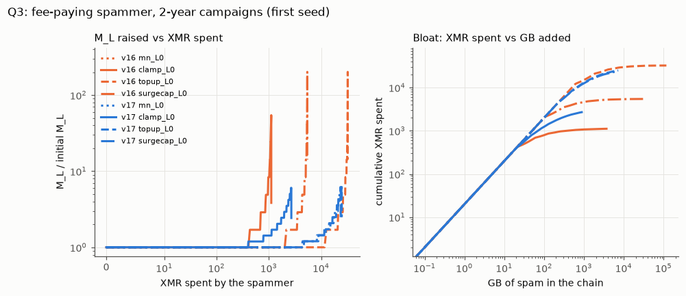

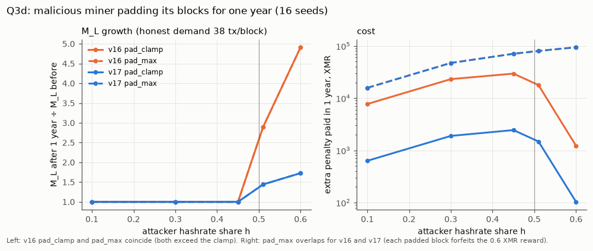

Fee-paying spammer, with users at 38 tx/block on default wallets (8 seeds for (a), 4 for (b, c)):

| goal | v16 | v17 | v17 ÷ v16 |
|---|---|---|---|
| (a) keep blocks at M_N for 1 day (no backlog) | 3.0 XMR | 3.9 XMR | 1.33 |
| (a) … for 7 days | 20.7 | 27.6 | 1.33 |
| (a) … for 30 days | 88.6 | 117.9 | 1.33 |
| (a) what it costs users: extra fees per day | 4.1 XMR | 14.1 XMR | 3.5 |
| (a) 30 days, keeping a block of backlog at the lowest fee | 3,145 (M_N → 15 MB) | 1,823 (M_N → 5 MB) | 0.58 |
| (a) the same, naive spammer at the wallet's auto level | 19,443 | 7,922 | 0.41 |
| (b) raise M_L to 2× (lowest fee, fill to clamp × M_L) | 687 XMR, 140 days | 1,440 XMR, 279 days | 2.1 |
| (b) raise M_L to 4× | 866 XMR, 215 days | 2,358 XMR, 558 days | 2.7 |
| (b) same at the top wallet level, to 2× | 104,627 | 192,753 | 1.8 |
| (c) add 10 GB (cheapest strategy; first seed) | 201 (69 days) | 202 (53 days) | 1.0 |
| (c) add 100 GB | 793 (185 days) | 1,238 (235 days) | 1.6 |
| (c) add 1,000 GB | 1,073 (463 days) | 12,542 (237 days) | 11.7 |
| (c) add 10,000 GB | 5,393 (548 days) | not reachable in 2 years | – |
| 2 years of clamp spam | 1,114 XMR, 3.7 TB, 0.30 XMR/GB | 2,695 XMR, 0.88 TB, 3.05 XMR/GB | – |

Days in (b) count from the start of the campaign. The (c) days are when the cheapest strategy reached that size,
not the fastest.

* **The (a) rows compare different amounts of free space, not different prices.** Both chains charge 20 XMR/GB
  for filler. At 38 tx/block the spammer has 274 kB per block to fill on v17 (625 kB zone, 55% used) and 206 kB
  on v16 (300 kB zone, 32% used); the ×1.33 is that ratio. Users' extra fees differ because v17's transactions
  are 3.6× heavier and the "normal" multiplier applies to a larger base.
* **Why the backlog rows cost less on v17.** With a backlog, the ratchet of Q1 makes blocks grow, and the spam
  must fill them. Blocks stop growing at 8·M_L = 5 MB on v17 against 50·M_L = 15 MB on v16, so the v17 spammer
  spends less and adds less: 91 GB in 30 days against 157 GB.
* **The naive spammer pays 4×.** Its own backlog makes the wallet logic choose "normal".
* **Why growth makes bloat cheap.** At steady size, bloat costs 20 XMR/GB under both rule sets. A spammer who first
  raises M_L pays less per byte, because the minimum fee per byte is R·T_R/M_L².
* **Users pay, but don't wait.** While blocks are kept full, users' transactions pay "normal" (0.0007 instead of
  0.00018 XMR on v17; 0.0002 instead of 0.00005 on v16). They are mined ahead of the spam, with no extra wait.

Malicious miner padding its own blocks for one year (16 seeds), with honest demand at 38 tx/block: 0.55·Z_M for
v17 and 0.32·Z_M for v16:

| h | target | v16: penalty paid, M_L × | v17: penalty paid, M_L × |
|---|---|---|---|
| 10%, 30%, 45% | any | M_L unchanged (median) | M_L unchanged |
| any | pad to M_N | 0 XMR (free: 5–32 GB/yr) | 0 XMR (7–44 GB/yr) |
| 51% | clamp × M_L | 17,857 XMR, ×2.89 | 1,481 XMR, ×1.44 |
| 60% | clamp × M_L | 1,225 XMR, ×4.91 | 103 XMR, ×1.73 |
| 51% | 2·M_N (whole reward) | 80,428 XMR, ×2.89 | 80,428 XMR, ×1.44 |

At 60% the attacker's blocks also hold up M_S, so its padding becomes almost penalty-free. In M_L terms, a majority
miner achieves far less under v17's 1.2 clamp than under 1.7. A fee-paying spammer at the lowest fee doubles M_L
faster on v17 (279 days) than a 51% miner does: the miner reaches only ×1.44 in a year.

Minority miner when honest demand is close to Z_M (`q3e_miner_busy`, 8 seeds; M_L at the end of a year of padding
to the clamp ÷ M_L at its start; without an attacker it stays at 1.000):

| honest demand | v16, h = 30% | v16, h = 45% | v17, h = 30% | v17, h = 45% |
|---|---|---|---|---|
| 0.5·Z_M, 0.8·Z_M | 1.000 | 1.000 | 1.000 | 1.000 |
| 0.9·Z_M | 1.000 | 1.018 | 1.000 | 1.060 |
| 0.95·Z_M | 1.015 | 1.074 | 1.033 | 1.108 |

When honest blocks sit just below M_L, the attacker's blocks shift which honest block is the median. The miner
strategies here are simple fixed targets, not optimised.

### Q4 Recovery (`scenarios/q4_recovery.json`; `tables/q4.md`; 8 seeds)

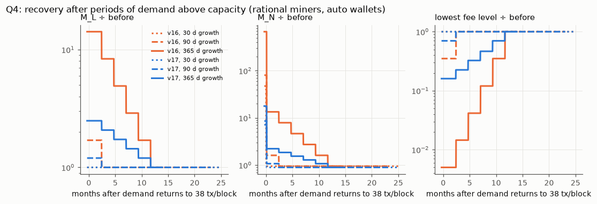

| growth phase | rules | M_L at end (MB) | +1 month | +3 months | +6 months | +12 months | min fee at end ÷ before | back to ≤ 1.1× base |
|---|---|---|---|---|---|---|---|---|
| 30 days | v16 | 0.30 | 0.30 | 0.30 | 0.30 | 0.30 | 1 | M_N in 0.1 days |
| 30 days | v17 | 0.625 | 0.625 | 0.625 | 0.625 | 0.625 | 1 | M_N in 0.2 days |
| 90 days | v16 | 0.51 | 0.51 | 0.30 | 0.30 | 0.30 | 0.35 | 69 days |
| 90 days | v17 | 0.75 | 0.75 | 0.625 | 0.625 | 0.625 | 0.70 | 70 days |
| 1 year | v16 | 4.26 | 4.26 | 2.51 | 1.47 | 0.30 | 0.005 | 347 days |
| 1 year | v17 | 1.56 | 1.56 | 1.30 | 1.08 | 0.625 | 0.16 | 347 days |

* **M_N** falls back to M_L as soon as the leftover backlog has cleared, which takes hours with the pool capped.
* **M_L** stays flat for 50,000 blocks, then steps down by the clamp ratio per 50,000 blocks: 5 steps from
  1.56 MB for v17, 5 from 4.26 MB for v16. Decay is as fast as growth was, never faster.
* **After 2 years of clamp spam (Q3b),** M_L twelve months later is still 1.52 MB (v17) or 1.15 MB (v16). The
  minimum fee is then 6× (v17) and 14× (v16) below its pre-attack value.

### Q5 Fee market (`scenarios/q5_fee_market.json`, `q5c_step.json`, `q5b_daily.json`; `tables/q5.md`)

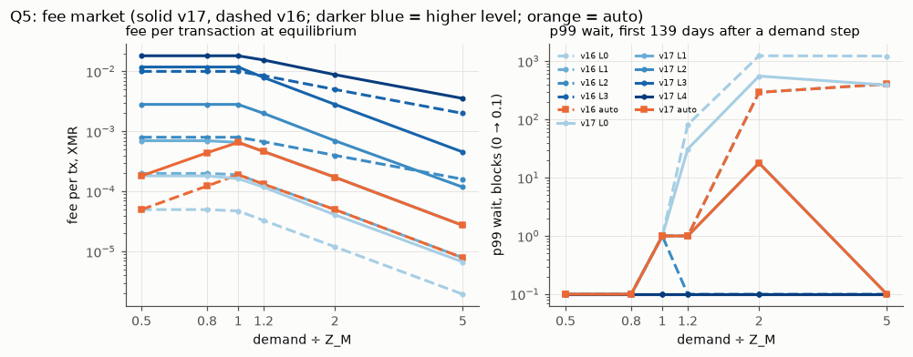

Equilibrium (800,000 blocks of constant Poisson demand, measured over the last 100,000; 8 seeds; M_L had stopped
moving in every run with default wallets), wallets on auto priority:

| demand | v17: M_L (MB), fee/tx, max wait | v16: M_L (MB), fee/tx, max wait |
|---|---|---|
| 0.5·Z_M | 0.625, 0.00018, 0 | 0.30, 0.00005, 0 |
| 0.8·Z_M | 0.625, 0.00044, 4 | 0.30, 0.00012, 2 |
| 1.0·Z_M | 0.65, 0.00066, 2 | 0.31, 0.00019, 1 |
| 1.2·Z_M | 0.77, 0.00046, 1 | 0.37, 0.00013, 1 |
| 2·Z_M | 1.28, 0.00017, 1 | 0.61, 0.00005, 1 |
| 5·Z_M | 3.18, 0.000027, 1 | 1.52, 0.000008, 1 |

The first 139 days after demand jumps from a chain at steady state (`q5c_step`, 16 seeds):

| demand | v17: fee/tx, p99 wait, max wait | v16: fee/tx, p99 wait, max wait |
|---|---|---|
| 1.0·Z_M | 0.00070, 1, 51 | 0.00020, 1, 62 |
| 1.2·Z_M | 0.00062, 1, 413 | 0.00018, 1, 789 |
| 2·Z_M | 0.00060, 18, 1,055 | 0.00014, 291, 2,048 |
| 5·Z_M | 0.00060, 0, 567 (0.4% dropped) | 0.00014, 406, 1,138 (0.8% dropped) |

* **Why the first months cost more.** In the first months M_L has taken only one step (to 750 kB on v17), so
  fees don't yet reflect demand.
* **The 5·Z_M ramp.** The p99 of 0 at 5·Z_M is a window effect, not a pool effect: the transactions that waited
  arrived during the ramp, which covers under 1% of the 100,000-block window, and only 0.4% of the window's
  transactions were evicted.
* **Over M_N at equilibrium.** Once demand is at or above Z_M, 45–47% of blocks exceed M_N on v17, by 0.8–3.8% on
  average (v16: 47–48%, by 0.3–1.7%).

How far past M_N a block can go (analytic, from `affordable_txs`; v17; full table with v16 in `tables/q5.md`):

| level | M_N = M_L | M_N = 2·M_L | M_N = 8·M_L |
|---|---|---|---|
| L0 1× | 1.017 | 1.024 | 1.081 |
| L1 4× | 1.047 | 1.084 | 1.32 |
| L2 16× | 1.17 | 1.32 | 2 |
| L3 64× | 1.65 | 2 | 2 |
| L4 f_X | 2 | 2 | 2 |

Any value above 1 at M_N = M_L means that a backlog at that level makes the short-term median climb. The
increase compounds, because fees are tied to M_L while the overshoot scales with M_N²/M_L².

**Daily cycle around Z_M** (amplitude 0.5–0.9, v17, auto):

* **At Z_M:** mean waits 20–57 blocks, p99 48–108, max 440–510.
* **At 1.5·Z_M:** mean 57–82, p99 162–249, max about 770.
* **Users-pay-more:** about 1–1.5 blocks, at 6.7–8.5× the fee.

### Q6 Parameter sensitivity (`scenarios/q6_sensitivity.json`; `tables/q6.md`, `tables/q6_main_effects.csv`)

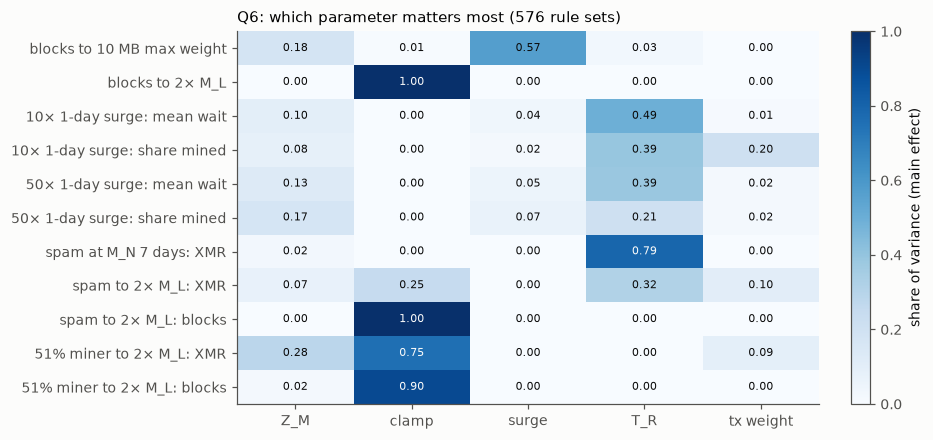

| metric (log10(x+1)) | runs with a value | Z_M | clamp | surge | T_R | tx weight | sum |
|---|---|---|---|---|---|---|---|
| blocks to 10 MB limit | 576/576 | 0.18 | 0.01 | 0.57 | 0.03 | 0.00 | 0.78 |
| blocks to 2× M_L | 576/576 | 0.00 | 1.00 | 0.00 | 0.00 | 0.00 | 1.00 |
| 10× 1-day surge: mean wait | 576/576 | 0.10 | 0.00 | 0.04 | 0.49 | 0.01 | 0.64 |
| 10× 1-day surge: share mined | 576/576 | 0.08 | 0.00 | 0.02 | 0.39 | 0.20 | 0.70 |
| 50× 1-day surge: mean wait | 576/576 | 0.13 | 0.00 | 0.05 | 0.39 | 0.02 | 0.59 |
| 50× 1-day surge: share mined | 576/576 | 0.17 | 0.00 | 0.07 | 0.21 | 0.02 | 0.47 |
| spam at M_N for 7 days, XMR | 576/576 | 0.02 | 0.00 | 0.00 | 0.79 | 0.00 | 0.82 |
| spam to 2× M_L, XMR | 392/576 | 0.07 | 0.25 | 0.00 | 0.32 | 0.10 | 0.74 |
| 51% miner to 2× M_L, XMR | 448/576 | 0.28 | 0.75 | 0.00 | 0.00 | 0.09 | 1.13 |

* **What the shares are.** Each parameter's share is computed on its own. A `sum` below 1 is variance that
  interactions explain, such as T_R × transaction weight. A sum above 1 means leaving out the runs where the
  event never happened has unbalanced the design, so the shares overlap.
* **Two rows hold by construction:** the clamp sets the doubling time, and the minimum fee, hence spam cost, is
  proportional to T_R.

How each parameter moves the metrics (geometric means over the rest of the grid):

* **Clamp ratio 1.1 → 1.7:** time to double M_L falls from 400k to 100k blocks. A 51% miner's cost to do it
  rises from 131 to 9,300 XMR, since a larger clamp means more penalty per padded block.
* **Surge factor 4 → 50:** the time for the limit to reach 10 MB falls from 168k to 1.5k blocks. The share of a
  one-day 50× surge that gets mined barely moves (11% → 17%); the pool cap binds first.
* **T_R 3,000 → 20,000:** the cost of 7 days of full blocks rises from 6.1 to 33 XMR. In a one-day 10× surge the
  mean wait falls from 539 to 204 blocks and the share mined rises from 46% to 74%.
* **T_R below the transaction weight.** With T_R = 3,000 the minimum-fee spammer never doubled M_L. With
  T_R = 10,000 and 11,851-byte transactions it did so in only 17% of rule sets.

### Q7 The fork transition (`scenarios/q7_fork.json`, `q7b_fork_mainnet.json`; `tables/q7.md`)

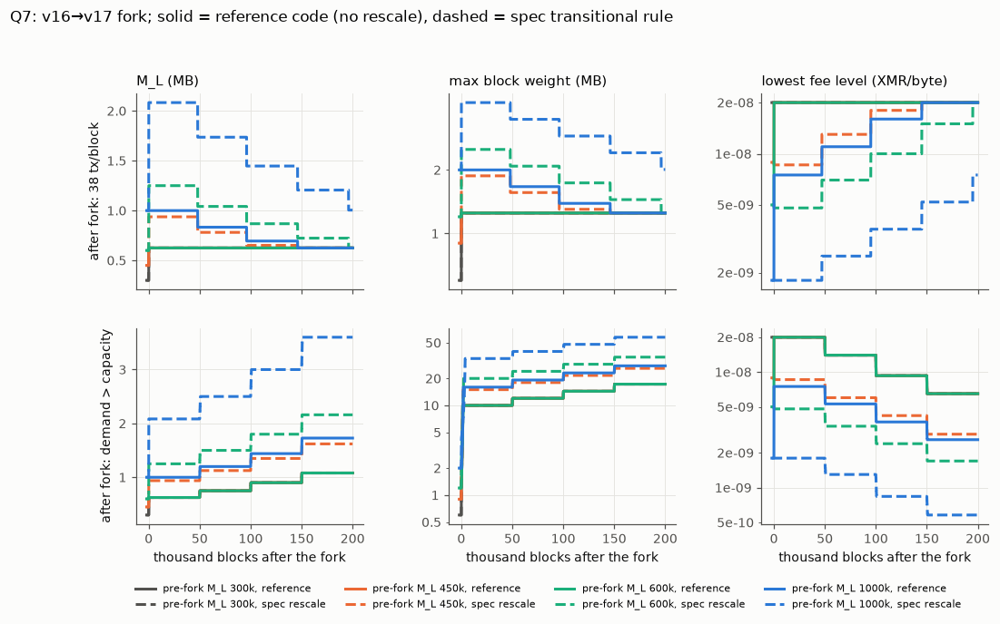

Pre-fork windows filled with M_L = X; demand after the fork is 38 tx/block. "ref" is the reference code and
"spec" the transitional rule. At the first post-fork block (both readings of the rule agree here):

| X | M_L ref / spec | max weight ref / spec | f_L ref / spec (XMR/byte) | f_L just before the fork |
|---|---|---|---|---|
| 300k | 625k / 625k | 1.25 / 1.25 MB | 2.0e-8 / 2.0e-8 | 2.0e-8 |
| 450k | 625k / 938k | 1.25 / 1.88 MB | 2.0e-8 / 8.6e-9 | 8.9e-9 |
| 600k | 625k / 1,250k | 1.25 / 2.5 MB | 2.0e-8 / 4.8e-9 | 5.0e-9 |
| 1M | 1,000k / 2,083k | 2.0 / 4.17 MB | 7.5e-9 / 1.8e-9 | 1.8e-9 |
| 2M | 2,000k / 4,167k | 4.0 / 8.33 MB | 1.9e-9 / 4.4e-10 | 4.5e-10 |

* **Fees.** The rescale keeps the per-byte minimum fee nearly continuous across the fork, because
  (625/300)² ≈ 12,500/3,000, the T_R ratio. Without it, fees per byte jump 2.3–4.5× on top of the 3.6× larger
  transactions.
* **Duration.** With demand at 38 tx/block, the differences fade only as pre-fork weights leave the window: about
  146,000 blocks for X = 450k and 196,000 for 600k (2,000 more under the re-clamped reading). With demand above capacity after the fork and X ≥ 450k,
  they persist for all 200,000 blocks simulated (for X = 300k the runs differ for 1,259 blocks or not at all).
* **Where the two readings differ.** They disagree only later, in the synthetic runs with X ≥ 1M and demand
  falling after the fork. There the largest fee gap reaches 6.4× with re-clamping vs 4.4× without.

From the real mainnet windows (Q7b, 8 seeds):

| demand after fork | effect of the rule (both readings) |
|---|---|
| 38 tx/block | none: the series are identical |
| 3× today's transactions | M_N differs from 29–39 blocks after the fork (short-term window); M_L 7.1–7.7% higher at +50,000 blocks, 4.1–4.3% at +100,000 |
| above capacity | M_L and M_N 7.5–7.7% higher from about 46,000 blocks after the fork, minimum fee per byte 14–15% lower; end-of-run M_L 1,158 kB vs 1,080 kB |

These come from the rescaled pre-fork weights carrying the median once post-fork weights make up half the
window. Mainnet's pre-fork long-term weights reach 456,144, and 456,144 × 625/300 = 950k is above most post-fork
weights. Re-clamping caps that tail at v17's 750k, but the tail still ranks above the early post-fork weights,
and the median depends only on rank. So both readings give the same result.

## Limitations

* **Miners and wallets are idealised.** Miners are perfectly rational and fully informed. Wallets use the
  documented levels without fee bumping. Users don't drop out, react to waits or resend dropped transactions,
  except under users-pay-more. Dropped transactions are counted as unserved demand.
* **Attacker strategies are simple fixed policies.** Optimised or mixed strategies (for example a <50% miner
  combined with spam, or a miner tuning its target to M_S) may be cheaper than the numbers here.
* **No network, verification, propagation or orphaning costs.** In particular, monerod's P2P layer carries at most
  100 MB per message (`LEVIN_DEFAULT_MAX_PACKET_SIZE`), so the 50–100 MB sizes in Q1 are beyond what nodes relay
  today. Verification isn't free either: on stressnet, a 2007 four-core machine took 38–66 CPU-ms per input (±25%
  between monerod builds) and 74–76 s of wall time for a full 10 MB block of 128-input transactions, against a
  120 s block time. A 100 MB block would take that machine over 12 minutes.
* **The pool is modelled at block granularity.** Pruning follows monerod's order: lowest fee level first, then
  the newest. Real pools also order transactions that arrived within the same 2 minutes by receive time; here
  those are taken smaller first and pruned larger first.
* **Equal transaction weight within a class; fees evaluated at inclusion, not at sending.** monerod fixes a fee
  when the transaction is sent. For v17's levels this changes nothing measurable: f_L moves by at most 1.6% over
  a 3-day pool life. v16's top level ("Fh") falls as the short-term median rises, so the v16 cost of spam at the
  top level (104,627 XMR to double M_L) is understated, by up to 3× on the part of the backlog mined after the
  ramp. No other number uses that level.
* **The malicious miner pads with zero-fee filler** rather than mining the backlog. With an empty pool, as in
  Q3d and Q3e, this is exact. With a backlog it overstates the miner's cost, since fees would offset the penalty.
* **Reward fixed at 0.6 XMR.** Penalties and fees in XMR scale with it.
* **Spam budgets** (`budget_xmr`) are checked on mined spend, so a budgeted spammer can overshoot by what is still
  pending. No scenario in this study sets a budget.
* **Attacker cost counts only spam that was mined.** Spam dropped by the pool or expired costs nothing, as in
  monerod. In every Q3 run that figure is zero.
* **Q6's "time to double M_L" counts from block 0,** 1,000 blocks before the campaign starts (1.4 days on
  100k–400k). Q3's times count from the campaign start.
* **Simple starting state.** Except for Q7b, every run starts from windows filled with Z_M, which matches
  mainnet's current M_L but not its short-term window. Demand starts instantly at its level.
* **Q6** uses one seed per rule set (576 sets) and first-order shares. Interactions are visible in the sums but
  not decomposed.
* **The transitional rule's exact computation** is not spelled out in the spec. Two readings were tested: scaling
  the stored long-term weights, and re-clamping the scaled block weights around the at-fork M_L. A third, re-running
  the rolling long-term computation over the scaled pre-fork weights block by block, was not; with M_L at the
  floor for the whole pre-fork window, as on mainnet, it coincides with the second.
* **Stressnet's sizes and speeds aren't mainnet's.** Its zone is 10 MB and its long-term window 10,080 blocks
  (flag 8). It was used only to confirm transaction weights, the 5/6 clamp and the slight overshoot of M_N, none
  of which depend on the window; not as a source of block-size dynamics.
* **Chain growth is counted in weight units.** On stressnet, FCMP++ transactions serialise to about 0.82–0.84
  bytes per unit of weight, so the GB figures in Q1 and Q3 overstate disk growth by roughly 20%.

## What changed from the first version

* **Q2 now models monerod's pool limits** (648 MB, 3 days); the first version had an unbounded pool. Its largest
  waits (4,988 blocks for a week-long 50× surge on v17, with a 60 GB backlog) were queues monerod wouldn't hold.
  Those transactions are now dropped: 32% of that surge is mined, with a 117-block mean wait. The claim that the
  8× cap makes sustained 20–50× surges wait 6–21× longer is withdrawn. The cap now matters only for a week-long
  50× surge (32% vs 78% mined); for shorter surges the pool limit binds first.
* **Q5's "steady-state" fees were not steady state.** They were averages over the first 139 days after a demand
  step, while M_L was still climbing; that is why 2·Z_M and 5·Z_M showed the same fee. Equilibrium fees above Z_M
  are 3–22× lower (table above).
* **Q1's "time to N MB blocks" was the time for the limit.** With rational miners, actual blocks of that size come
  one M_L doubling later. For example, 100 MB on v17 takes 1,181 days, not 903.
* **Mixed transaction sizes were mined by size class, not arrival order.** The first version's v17-mix waits
  (slightly shorter than single-size v17) were an artifact of that. They are now in line with single-size v17
  (277 vs 274 blocks for a one-day 5× surge).
* **Q3** adds the cost of minimum-fee spam to users (fees about 4×). It also qualifies "attacks cost the same or
  more on v17": backlog spam is cheaper on v17.

Third revision, after a second review:

* **The Q3 headline was wrong.** It said growing the chain by attack was "dearer and slower" on v17; the table
  under it shows 1 TB arriving in 237 days on v17 against 463 on v16. Only raising M_L is slower (the clamp), and
  the per-byte price of filler is the same on both. The ×1.33 and ×0.58 in Q3a were presented as rule effects;
  they are the ratio of free space at 38 tx/block and the ratio of bytes added.
* **The v16 control with 9,093-byte transactions was congested before its surge** (38 × 9,093 = 345 kB in a
  300 kB zone). A second control at 18 tx/block, the same 55% of the zone as v17, replaces it in the comparison:
  v17 queues less at 5× (274 vs 387 blocks) but loses more at 10× and above, because the pool is the same 648 MB
  on both chains.
* **Q3's days now count from the start of the campaign,** not from block 0 (1.4 days less).
* **Figures:** the bloat panel's axis was broken by a headroom adjustment made before the log scale was set; the
  Q2 example hid v17 under the identical 50×-cap run, now drawn dashed on top; coinciding series are labelled.
* **Limitations** now list the three modelling choices found by a code review against monerod's source
  (inclusion-time fees, zero-fee padding, budget on mined spend) with their direction; the consensus and fee
  functions themselves matched monerod and `fcmp++-stage` line for line.
* **Stressnet's shorter long-term window** (10,080 blocks) is recorded alongside its 10 MB zone; no number in the
  study depended on it. Node addresses were removed from the text.
* **The malicious miner below 50%:** "cannot move M_L at all" holds only when honest demand is well below Z_M
  (new scenario `q3e_miner_busy`).
* **Q7:** the spec's text covers the short-term median too, so the early difference is what the spec asks for.
  Recomputing pre-fork long-term weights with v17's clamp doesn't change the mainnet result.
* **Q1b at 400% a year:** the first version's "p99 wait 105,125 blocks" was an average of maxima, because the wait
  histogram overflowed at 60 days. Now the histogram is exact, and the result is that 48% of transactions are
  dropped.
* **Smaller corrections** to numbers and wording: the 10×-surge cap comparison, the Q5 overshoot range, the
  users-pay-more fee range, and Q4's M_N recovery.

## Reproduce

```
git clone https://github.com/Fountain5405/adaptiveblocksizesim && cd adaptiveblocksizesim
git checkout study-2026
python3 -m venv ~/studyvenv && ~/studyvenv/bin/pip install matplotlib numpy pandas
PYTHON=~/studyvenv/bin/python study/run_all.sh                      # tests, all scenarios, figures, tables (~2.5 min on 12 cores)
MONERO_RPC=http://127.0.0.1:18081 PYTHON=... study/run_all.sh        # also refreshes data/mainnet_weights.csv.gz
cd study && ./target/release/study scenarios/q2_surge.json --out results   # one scenario
MONERO_RPC=http://<stressnet-node>:<rpc-port> python3 scripts/fetch_chain.py data/stressnet_weights.csv.gz 120000
```

`run_all.sh` needs `cargo` on the PATH.

* **Committed:** `results/*/summary.csv`, `events.csv`, `runs.jsonl` and `meta.json` (git commit, scenario text,
  seeds).
* **Not committed:** the per-run series. `run_all.sh` regenerates them, because they are over the ~50 MB
  guideline.
* **Caveat:** refreshing the mainnet data moves the chain window, so Q7b will then differ slightly from the
  committed results.

## Files

| Path | Contents |
|---|---|
| `wasm-sim/src/lib_core/step.rs` | steppable simulator and its regression tests |
| `study/src/{main,spec,run}.rs` | harness: scenario expansion, parallel runs, metrics, output |
| `study/scenarios/*.json` | the scenarios behind every number (`pilot/` holds the pilots) |
| `study/analysis/analyze.py` | figures and tables, including `tables/key_numbers.md` |
| `study/figures/`, `study/tables/` | outputs referenced above |
| `study/data/` | mainnet and stressnet weight histories |
